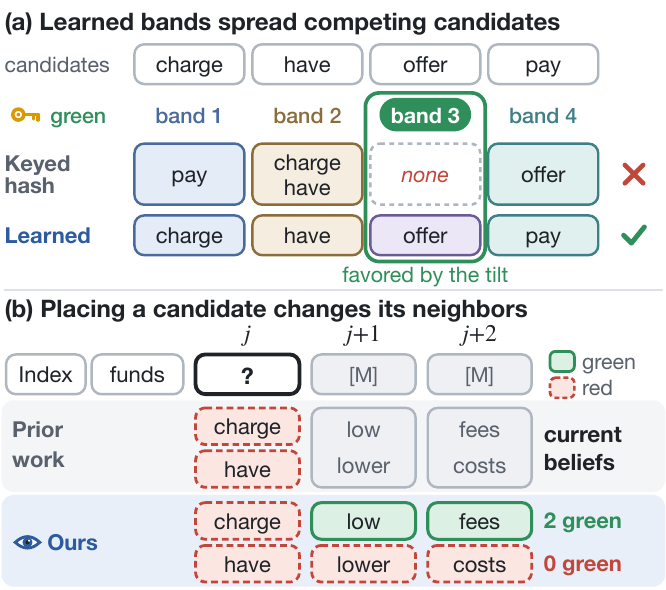

<div align="center">

# Watermarking Diffusion Language Models<br>with Learned Foresight and Balanced Bands

**Hyojun Kim · Hyeseon An · Yo-Sub Han**<br>
Yonsei University

[](#citation)
[](https://hyojuun.github.io/lfbb/)
[](LICENSE)




</div>

Diffusion language models such as LLaDA and Dream unmask a canvas of tokens in an order that is not left to right, so a green-red
watermark often has to choose a token before the tokens that select its green list, and that token later shapes the green lists of
its neighbors. Following DLM-KGW, every commit maximizes the detector's expected evidence under a KL penalty. This repository learns
the two components that green-red DLM watermarks keep fixed:

- **Learned bands.** A partition of the vocabulary into four bands, learned from decoding traces so that competing candidates fall into
  different bands. A keyed hash of the context still picks the green band, so the null distribution of the detector stays exact.
- **A foresight predictor.** A network built from the generator's top layers that estimates how placing each candidate changes its
  neighbors' beliefs, in one batched pass for all candidates of a commit.

The tilt also counts evidence the way the detector does, once per distinct (context, token) unit, so repetition earns nothing.
Detection needs only the text, the key and the partition. It never runs the language model or the predictor.

## Contents

- [Installation](#installation)
- [Quick start](#quick-start)
- [Development prompts](#development-prompts)
- [Learning the components](#learning-the-components)
- [Evaluation](#evaluation)
- [Repository structure](#repository-structure)
- [Citation](#citation)

## Installation

Two Python environments keep the generators' pinned Transformers version apart from the evaluation libraries.

```bash
pip install -r requirements.txt          # decoding, training, detection, prompt preparation (Transformers 4.49)
pip install -r requirements-eval.txt     # separate environment for score_ppl.py, judge.py and attack_paraphrase.py (vLLM)
```

Python 3.10 or later and a CUDA GPU are required. The baselines run from their official code:

```bash
git clone https://github.com/eth-sri/diffusion-lm-watermark external/diffusion-lm-watermark
git -C external/diffusion-lm-watermark checkout 380a4bef
git clone https://github.com/pyomin/dgmark-watermarking external/dgmark-watermarking
git -C external/dgmark-watermarking checkout cb6d79ff
```

All commands below run from the repository root.

## Quick start

**Detect.** Detection needs the key and the partition, not the language model.

```python
from transformers import AutoTokenizer
from lfbb import detect, load_partition, load_special_ids

tok = AutoTokenizer.from_pretrained("GSAI-ML/LLaDA-8B-Instruct", trust_remote_code=True)
part = load_partition("checkpoints/bands.pt", key=42, special_ids=load_special_ids("data/special_ids_llada.json"), device="cpu")
n, k, z, p = detect(part, tok(text, add_special_tokens=False)["input_ids"])   # units, green units, z-score, exact p-value
```

`load_partition("hash", ...)` gives the keyed-hash partition of standard green-red watermarks instead.

**Generate.** Watermarked decoding of a prompt file with LLaDA-8B-Instruct:

```bash
python scripts/generate.py --arms configs/arms/ours_d3_d4.json --partition checkpoints/bands.pt \
    --predictor checkpoints/predictor.pt --prompts data/dev150_prompts_llada.jsonl --out runs/quickstart
```

Each output row holds the response, its detection (`n`, `k`, `z`, `p`) and the KL divergence of the tilt. An arm config sets the
strength `delta` as the logit bias added before the temperature (the paper reports δ = 2·`delta`), the foresight weight `lam`, the
source of foresight (`predictor` or `current`), the commit order and the predictor gate. `--commits-per-step K` unmasks K tokens per
forward pass, and `--refresh 2` lets the predictor update the beliefs around each commit within a step.

## Development prompts

The prompts are split before anything is learned or tuned, and the evaluation prompts are never used to compare settings.

| Split | File | Prompts | Used for |
|---|---|---|---|
| Train | `data/train_prompts_llada.jsonl` | 3,000 (1,000 per task) | decoding traces for the partition, decision states for the predictor |
| Development | `data/dev150_prompts_llada.jsonl` | 150 (50 per task) | comparing settings of the watermark (`scripts/select_dev.py`) |
| Confirmation | `data/devB150_prompts_llada.jsonl` | 150 (50 per task) | one check before freezing, needed only when two or more settings change |
| Evaluation | WaterBench-600 (`scripts/prepare_waterbench.py`) | 600 | the reported results, decoded once with the frozen setting |

The training and development prompts come from the train and dev splits of ELI5, FiQA and AlpacaFarm, the evaluation prompts from
WaterBench, and no prompt appears in two sets. `scripts/select_dev.py` compares settings on the development prompts with a rule fixed
before decoding. It compares each candidate with the reference by the mean z-score gain at equal KL, with a bootstrap interval, and
adopts it only when the interval lies above zero and the judge score, the log-perplexity and the share of repetition loops do not get
worse. The confirmation prompts check a combination once when two or more settings change.

```bash
python scripts/reproduce.py configs/reproduce/dev_selection.json   # decode the candidates on the development prompts and compare
```

The arm configs `configs/arms/ours_*.json` use the settings of the paper: a foresight weight λ = 1/2, so that the two dependents
together weigh as much as the position itself, four bands, two-token contexts, the consistent commit order, a predictor gate of 0.02,
the unit-aware score and special tokens treated as red.

## Learning the components

```bash
python scripts/reproduce.py configs/reproduce/components.json
```

1. **Traces.** The 3,000 training prompts are decoded without a watermark in the low-confidence order used for evaluation
   (`collect_records.py`).
2. **Partition.** Coordinate ascent on these traces assigns every token to a band so that the likely candidates of a commit are spread
   over the bands (`learn_bands.py`, four bands, and eight for the comparison on the development prompts).
3. **Decision states.** The training prompts are decoded again with the watermark, and at every uncertain commit each of the top-8
   candidates is placed and the generator re-run, which records the exact post-placement beliefs of its neighbors (`collect_states.py`).
4. **Predictor.** Copies of the generator's top eight layers and an adapter are distilled on these states, keeping the epoch with the
   lowest loss on held-out training prompts (`train_predictor.py`).

The partition and the predictor are kept secret together with the key, so they are not distributed. The scripts above learn both.

## Evaluation

Each file in `configs/reproduce/` lists the commands of one result, and `scripts/reproduce.py` runs them in order. `--dry-run` prints
them, `--only NAME` runs one step, and `--set PY_EVAL=/path/to/eval-env/bin/python` points the scoring steps to the evaluation
environment. Generation resumes where it stopped.

```bash
python scripts/reproduce.py configs/reproduce/table1.json   # comparison with DLM-KGW and dgMARK on WaterBench-600
python scripts/reproduce.py configs/reproduce/table2.json   # the partition crossed with the source of foresight
```

Thresholds are calibrated on unwatermarked responses, pooled over 100 keys for the keyed detectors. `scripts/report.py` gives the mean
z-score, the calibrated and nominal TPR at 1% and 0.1% FPR, log-perplexity (Qwen3-8B), KL, repetition loops and judge scores
(Gemma-4-12B-it), with paired bootstrap intervals for each contrast. Rows decoded together share their random numbers, so token-level
reproduction needs the same GPU type, library versions and config file.

<details>
<summary><b>Other experiments</b></summary>

| Experiment | Configs (`configs/arms/`) | Scripts and options |
|---|---|---|
| Code and QA | `ours_d3_d4` | `prepare_codeqa.py`, `eval_codeqa.py`; components learned on code and QA with `prepare_codeqa_train.py --ids data/codeqa_train_ids.json` and `train_predictor.py --init` |
| Dream-v0-Instruct-7B | `dream`, `dream_current` | `--family dream`; `transfer_partition.py` and `generate.py --transfer` for LLaDA's partition; `report.py --validity Dream-org/Dream-v0-Instruct-7B --missing-z 0` |
| Robustness | `robustness_d4`, `unwatermarked` | `--prompt-ids data/robustness90_ids.json`; `attack_paraphrase.py`, `attack_eval.py` |
| Other writing tasks | as for Table 1 | `--prompts data/other_tasks_llada.jsonl`, `report.py --datasets` |
| Several tokens per step | `ours_d3_d4`, `unwatermarked` | `generate.py --commits-per-step K --refresh {0,2}`; `run_dlm_kgw.py --steps 256/K` |
| Comparison over keys | `ours_d2_d3`, `current_d3_d4` | `--prompt-ids data/multikey300_ids.json --key K --arm-prefix kK_` |
| Context width | `context_width_1`, ..., `context_width_6` | `--prompts data/dev150_prompts_llada.jsonl`, `--context-width` |
| Foresight weight and gate | `lambda_sweep_d3`, `gate0_d3` | `--prompts data/dev150_prompts_llada.jsonl` |

Each script documents its options and gives an example in its header (`python scripts/<script>.py --help`).

</details>

**Preparing the evaluation prompts.** The WaterBench prompts are built from the official DLM-KGW repository, and the code and QA
prompts from their sources (GPQA is gated and must not be redistributed, so `data/codeqa/` stays local).

```bash
python scripts/prepare_waterbench.py --source external/diffusion-lm-watermark/data/WaterBench --out data/waterbench600_llada.jsonl
python scripts/render_prompts.py --texts data/other_tasks_prompts.jsonl --out data/other_tasks_llada.jsonl
python scripts/prepare_codeqa.py --humaneval raw/human-eval-v2-20210705.jsonl --mbpp raw/mbpp.jsonl --gpqa raw/gpqa_diamond.csv \
    --out-dir data/codeqa
```

## Repository structure

```
lfbb/                    the method: partition and green bands, detector, LLaDA and Dream samplers, foresight predictors
scripts/                 prompt preparation, learning the components, setting selection, generation, calibration, evaluation, attacks
scripts/baselines/       drivers for the official code of DLM-KGW and dgMARK
configs/arms/            watermark configurations, including the development candidates
configs/reproduce/       the commands of each result, run by scripts/reproduce.py
data/                    the training and development prompts, prompt id lists, special tokens
```

## Citation

```bibtex
@misc{kim2026watermarking,
  title         = {Watermarking Diffusion Language Models with Learned Foresight and Balanced Bands},
  author        = {Kim, Hyojun and An, Hyeseon and Han, Yo-Sub},
  year          = {2026},
  note          = {Preprint}
}
```

## License

The code is released under the [MIT License](LICENSE). The prompt files in `data/` come from ELI5 (via KILT), FiQA (via BEIR),
AlpacaFarm, C4, Dolly and WritingPrompts and keep the licenses of those sources, some of which allow only non-commercial use.
