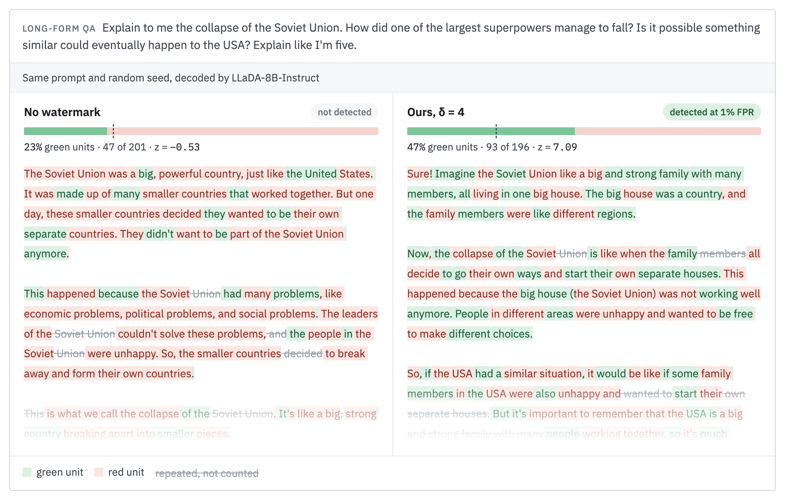
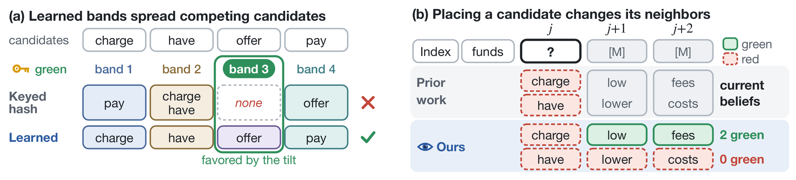
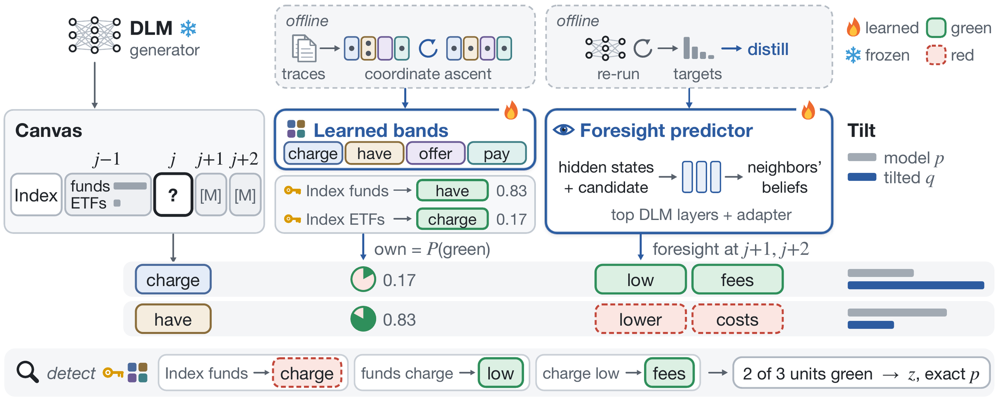
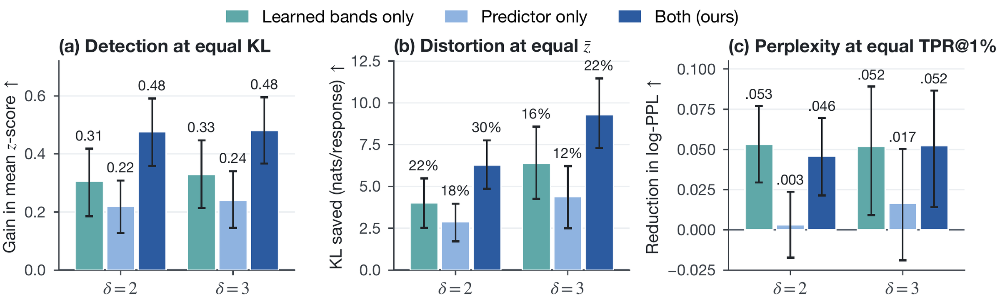

<div align="center">

# Watermarking Diffusion Language Models<br>with Learned Foresight and Balanced Bands

**Hyojun Kim · Hyeseon An · Yo-Sub Han**<br>
Yonsei University

[](#citation)
[](https://hyojuun.github.io/lfbb/)
[](LICENSE)




<sub>The same prompt and random seed, decoded by LLaDA-8B-Instruct without a watermark and with ours (δ = 4). Each token forms a unit with
its two preceding tokens, and the detector counts every distinct unit once. By chance about a quarter of the units are green, and the
watermark raises that share to 47%, a z-score of 7.1. The interactive version on the <a href="https://hyojuun.github.io/lfbb/">project page</a>
replays the decoding.</sub>

</div>

**TL;DR** Diffusion language models write out of order, so a green-red watermark often has to pick a token before it knows which
tokens are green. We learn the two parts that existing watermarks for these models keep fixed, which tokens compete for the same green
list and how a token changes its neighbors, and detect up to 18 points more responses at the same strength while matching the quality of
unwatermarked text.

## Why diffusion language models are hard to watermark

A diffusion language model writes the way people solve a crossword. It fills the blanks it is surest of first and comes back to the
rest. A green-red watermark, however, picks each token's green list from the tokens before it, and in LLaDA-8B-Instruct 39% of the
tokens are written while part of that context is still blank. The watermark therefore has to choose a token before it knows which list is
green, and the token it chooses then decides the green lists of the next two tokens.

Prior work, DLM-KGW, handles both cases with the model's predictions for the blanks. It tilts each choice toward tokens that are
likely to be green or that make their neighbors green. How much one choice can gain, though, depends on two things that it keeps fixed.

<p align="center">
  
</p>

- **(a) How the vocabulary is split into bands.** A keyed hash puts the two most likely candidates of a commit into the same band in a
  quarter of the commits, and when another band is green the tilt then has little to favor.
- **(b) Which predictions foresight reads.** Existing methods judge a candidate's effect on its neighbors from their predictions before
  the candidate is placed, which are the same for every candidate. Yet placing a candidate changes a masked neighbor's most likely token
  in about three quarters of the uncertain commits.

## Method

We keep the idea of tilting each commit toward green evidence and learn both of these parts.

<p align="center">
  
</p>

- **Learned bands.** A partition of the vocabulary into four bands, learned from decoding traces so that competing candidates fall into
  different bands. The key still picks the green band in each context, so the null distribution of the detector stays exact for any
  partition.
- **A foresight predictor.** An adapter and copies of the generator's top eight layers, distilled from the generator's own predictions
  after a candidate is placed. It scores every candidate of a commit in one batched pass and runs only for the position that wins the
  commit.
- **Evidence counted like the detector.** The tilt credits each distinct (context, token) unit once, as the detector counts it, so
  repetition earns nothing.

Detection needs only the text, the key and the band table. It never runs the language model or the predictor.

## Results

WaterBench-600 with LLaDA-8B-Instruct (low-confidence order, 256 tokens, temperature 0.5). TPR uses thresholds calibrated on 600
unwatermarked responses detected under 100 keys, log-perplexity is measured with Qwen3-8B, and the judge, Gemma-4-12B-it, rates style
and consistency from 1 to 10. Loops is the share of responses with a repetition loop. Baselines run from their official code.

| Method | δ | TPR@1% ↑ | TPR@0.1% ↑ | log-PPL ↓ | Judge ↑ | Loops (%) ↓ |
|---|:-:|:-:|:-:|:-:|:-:|:-:|
| No watermark | – | – | – | 1.297 | 9.12 | 19.3 |
| dgMARK (greedy) | – | 92.7 | 84.2 | 1.550 | 9.07 | 16.2 |
| DLM-KGW | 2 | 51.3 | 24.8 | **1.316** | 9.13 | 19.3 |
| **Ours** | 2 | **69.5** | **44.0** | 1.326 | **9.29** | **18.2** |
| DLM-KGW | 3 | 85.7 | 70.0 | **1.387** | 8.97 | 23.3 |
| **Ours** | 3 | **89.3** | **79.3** | 1.398 | **9.30** | **14.0** |
| DLM-KGW | 4 | 96.0 | 91.3 | 1.506 | 8.62 | 26.3 |
| **Ours** | 4 | **96.2** | **92.7** | **1.469** | **9.32** | **14.3** |
| DLM-KGW | 5 | 97.7 | 95.3 | 1.602 | 8.15 | 30.5 |
| **Ours** | 5 | **98.3** | **96.0** | **1.575** | **9.26** | **12.2** |

- **More detections where it is hardest.** At low strengths the quality cost is smallest but detection is uncertain. Averaged over five
  keys on 300 prompts, ours detects 12.7 and 4.5 points more responses than DLM-KGW at 1% FPR at δ = 2 and 3, with no significant
  difference in log-perplexity.
- **No loss of quality when the watermark is strong.** At δ = 4 and 5 the judge rates ours as high as unwatermarked text, while
  DLM-KGW drops to 8.62 and 8.15. Its tilt keeps rewarding repeated green units, and its share of looping responses grows from 19% to
  31%.
- **Each component helps, and their gains add up.** Learned bands raise the mean z-score by 0.41 to 0.47 at every strength and the
  predictor by 0.10 to 0.28 with either partition. Together they reach the same mean z-score with 30% and 22% less KL at δ = 2 and 3.
- **Beyond one model and one task.** LLaDA's bands transferred to Dream detect 75.5% of the responses at δ = 4 against 56.5% for
  DLM-KGW, and on code and question answering ours detects as many or more without a significant loss in accuracy.

<p align="center">
  
  <br><sub>Each component against keyed-hash bands with current predictions, in mean z-score at equal KL (a), KL saved at equal mean
  z-score (b) and log-perplexity at equal TPR@1% (c). Error bars are paired bootstrap 95% confidence intervals.</sub>
</p>

## Getting started

Two Python environments keep the generators' pinned Transformers version apart from the evaluation libraries. Python 3.10 or later and
a CUDA GPU are required.

```bash
pip install -r requirements.txt          # decoding, training, detection, prompt preparation (Transformers 4.49)
pip install -r requirements-eval.txt     # separate environment for score_ppl.py, judge.py and attack_paraphrase.py (vLLM)
```

The band table and the predictor are kept secret together with the key, so the ones behind the paper are not distributed. The commands
below use a band table and a predictor learned as in [Reproducing the paper](#reproducing-the-paper), and every command runs from the
repository root.

**Detect.** Detection needs the tokenizer, the key and the band table, but not the language model.

```python
from transformers import AutoTokenizer
from lfbb import detect, load_partition, load_special_ids

tok = AutoTokenizer.from_pretrained("GSAI-ML/LLaDA-8B-Instruct", trust_remote_code=True)
part = load_partition("checkpoints/bands.pt", key=42, special_ids=load_special_ids("data/special_ids_llada.json"), device="cpu")
n, k, z, p = detect(part, tok(text, add_special_tokens=False)["input_ids"])   # units, green units, z-score, exact p-value
```

`load_partition("hash", ...)` gives the keyed-hash bands of standard green-red watermarks, which need no training.

**Generate.** Watermarked decoding of a prompt file with LLaDA-8B-Instruct:

```bash
python scripts/generate.py --arms configs/arms/ours_d3_d4.json --partition checkpoints/bands.pt \
    --predictor checkpoints/predictor.pt --prompts data/dev150_prompts_llada.jsonl --out runs/quickstart
```

Each output row holds the response, its detection (`n`, `k`, `z`, `p`) and the KL divergence of the tilt. An arm config sets the
strength `delta` as the logit bias added before the temperature (the paper reports δ = 2·`delta`), the foresight weight `lam`, the
source of foresight (`predictor` or `current`), the commit order and the predictor gate. The configs `configs/arms/ours_*.json` use
the settings of the paper: a foresight weight λ = 1/2, so that the two dependents together weigh as much as the position itself,
four bands, two-token contexts, the consistent commit order, a predictor gate of 0.02, the unit-aware score and special tokens
treated as red. `--commits-per-step K` unmasks K tokens per forward pass, and `--refresh 2` lets the predictor update the beliefs
around each commit within a step.

## Reproducing the paper

The baselines, DLM-KGW and dgMARK, run from their official code at these commits:

```bash
git clone https://github.com/eth-sri/diffusion-lm-watermark external/diffusion-lm-watermark
git -C external/diffusion-lm-watermark checkout 380a4bef
git clone https://github.com/pyomin/dgmark-watermarking external/dgmark-watermarking
git -C external/dgmark-watermarking checkout cb6d79ff
```

Each file in `configs/reproduce/` lists the commands of one result, and `scripts/reproduce.py` runs them in order. `--dry-run` prints
them, `--only NAME` runs one step, and `--set PY_EVAL=/path/to/eval-env/bin/python` points the scoring steps to the evaluation
environment. Generation resumes where it stopped.

<details>
<summary><b>Prompt splits</b></summary>

The prompts are split before anything is learned or tuned, and the evaluation prompts are never used to compare settings.

| Split | File | Prompts | Used for |
|---|---|---|---|
| Train | `data/train_prompts_llada.jsonl` | 3,000 (1,000 per task) | decoding traces for the bands, decision states for the predictor |
| Development | `data/dev150_prompts_llada.jsonl` | 150 (50 per task) | comparing settings of the watermark (`scripts/select_dev.py`) |
| Confirmation | `data/devB150_prompts_llada.jsonl` | 150 (50 per task) | one check before freezing, needed only when two or more settings change |
| Evaluation | WaterBench-600 (`scripts/prepare_waterbench.py`) | 600 | the reported results, decoded once with the frozen setting |

The training and development prompts come from the train and dev splits of ELI5, FiQA and AlpacaFarm, and the evaluation prompts
from WaterBench, with no prompt in two sets. On the development prompts, `scripts/select_dev.py` applies a rule fixed before
decoding. It measures each candidate setting against the reference by the mean z-score gain at equal KL and adopts the candidate
only when the bootstrap interval of that gain lies above zero and the judge score, the log-perplexity and the share of repetition
loops do not get worse.

```bash
python scripts/reproduce.py configs/reproduce/dev_selection.json   # decode the candidates on the development prompts and compare
```

</details>

<details>
<summary><b>Learning the components</b></summary>

```bash
python scripts/reproduce.py configs/reproduce/components.json
```

1. **Traces.** The 3,000 training prompts are decoded without a watermark in the low-confidence order used for evaluation
   (`collect_records.py`).
2. **Bands.** Coordinate ascent on these traces assigns every token to a band so that the likely candidates of a commit are spread over
   the bands (`learn_bands.py`, with four bands, or eight for the band-count comparison on the development prompts).
3. **Decision states.** The training prompts are decoded again with the watermark, and at every uncertain commit each of the top-8
   candidates is placed and the generator re-run, which records the exact post-placement beliefs of its neighbors (`collect_states.py`).
4. **Predictor.** Copies of the generator's top eight layers and an adapter are distilled on these states, keeping the epoch with the
   lowest loss on held-out training prompts (`train_predictor.py`).

</details>

<details>
<summary><b>Evaluation</b></summary>

The WaterBench prompts are built from the official DLM-KGW repository, and the code and QA prompts from their sources (GPQA is gated
and must not be redistributed, so `data/codeqa/` stays local).

```bash
python scripts/prepare_waterbench.py --source external/diffusion-lm-watermark/data/WaterBench --out data/waterbench600_llada.jsonl
python scripts/render_prompts.py --texts data/other_tasks_prompts.jsonl --out data/other_tasks_llada.jsonl
python scripts/prepare_codeqa.py --humaneval raw/human-eval-v2-20210705.jsonl --mbpp raw/mbpp.jsonl --gpqa raw/gpqa_diamond.csv \
    --out-dir data/codeqa
python scripts/reproduce.py configs/reproduce/table1.json   # comparison with DLM-KGW and dgMARK on WaterBench-600
python scripts/reproduce.py configs/reproduce/table2.json   # the bands crossed with the source of foresight
```

Thresholds are calibrated on unwatermarked responses, pooled over 100 keys for the keyed detectors. `scripts/report.py` gives the mean
z-score, the calibrated and nominal TPR at 1% and 0.1% FPR, log-perplexity (Qwen3-8B), KL, repetition loops and judge scores
(Gemma-4-12B-it), with paired bootstrap intervals for each contrast. Rows decoded together share their random numbers, so token-level
reproduction needs the same GPU type, library versions and config file.

</details>

<details>
<summary><b>Other experiments</b></summary>

| Experiment | Configs (`configs/arms/`) | Scripts and options |
|---|---|---|
| Code and QA | `ours_d3_d4` | `prepare_codeqa.py`, `eval_codeqa.py`<br>components learned on code and QA with `prepare_codeqa_train.py --ids data/codeqa_train_ids.json` and `train_predictor.py --init` |
| Dream-v0-Instruct-7B | `dream`, `dream_current` | `--family dream`<br>`transfer_partition.py` and `generate.py --transfer` for LLaDA's bands<br>`report.py --validity Dream-org/Dream-v0-Instruct-7B --missing-z 0` |
| Robustness | `robustness_d4`, `unwatermarked` | `--prompt-ids data/robustness90_ids.json`<br>`attack_paraphrase.py`, `attack_eval.py` |
| Other writing tasks | as for Table 1 | `--prompts data/other_tasks_llada.jsonl`, `report.py --datasets` |
| Several tokens per step | `ours_d3_d4`, `unwatermarked` | `generate.py --commits-per-step K --refresh {0,2}`<br>`run_dlm_kgw.py --steps 256/K` |
| Comparison over keys | `ours_d2_d3`, `current_d3_d4` | `--prompt-ids data/multikey300_ids.json --key K --arm-prefix kK_` |
| Context width | `context_width_1`, ..., `context_width_6` | `--prompts data/dev150_prompts_llada.jsonl`, `--context-width` |
| Foresight weight and gate | `lambda_sweep_d3`, `gate0_d3` | `--prompts data/dev150_prompts_llada.jsonl` |

Each script documents its options and gives an example in its header (`python scripts/<script>.py --help`).

</details>

## Repository structure

```
lfbb/                    the method: bands and keyed green band, detector, LLaDA and Dream samplers, foresight predictors
scripts/                 prompt preparation, learning the components, setting selection, generation, calibration, evaluation, attacks
scripts/baselines/       drivers for the official code of DLM-KGW and dgMARK
configs/arms/            watermark configurations, including the development candidates
configs/reproduce/       the commands of each result, run by scripts/reproduce.py
data/                    the training and development prompts, prompt id lists, special tokens
```

## Citation

```bibtex
@misc{kim2026watermarking,
  title         = {Watermarking Diffusion Language Models with Learned Foresight and Balanced Bands},
  author        = {Hyojun Kim and Hyeseon An and Yo-Sub Han},
  year          = {2026},
  note          = {Preprint}
}
```

## License

The code is released under the [MIT License](LICENSE). The prompt files in `data/` come from ELI5 (via KILT), FiQA (via BEIR),
AlpacaFarm, C4, Dolly and WritingPrompts and keep the licenses of those sources, some of which allow only non-commercial use.
